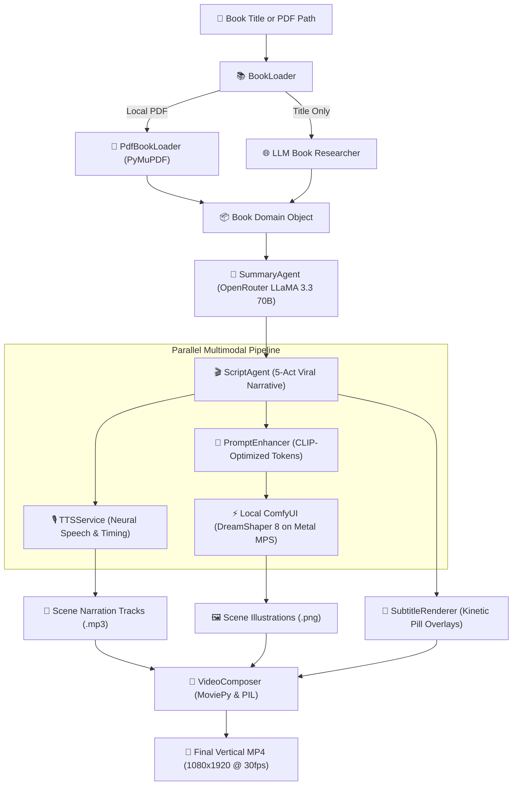

# Narrify AI — Technical Specification & Architecture

## Executive Summary

**Narrify AI** is an automated, multimodal generative pipeline that turns literature into short-form vertical videos (9:16, 1080×1920) optimized for YouTube Shorts, Instagram Reels, and TikTok.

Users can either provide an existing PDF path or simply **type any book title directly** (e.g. `"The Psychology of Money"`, `"Deep Work"`). The system automatically researches and synthesizes book dossiers via cloud LLMs without requiring manual PDF downloading.

The engine coordinates:
1. **Multi-Mode Book Ingestion** (`BookLoader`): Direct PDF parsing, local folder fuzzy matching, or zero-download LLM book research.
2. **Cloud LLMs** (OpenRouter `meta-llama/llama-3.3-70b-instruct`) for high-context book research and 5-act viral narrative structuring.
3. **Local Diffusion Models** (ComfyUI with `DreamShaper_8` on Apple Silicon Metal Performance Shaders) for high-aesthetic scene illustrations without cloud subscription fees.
4. **Ultra-Realistic Neural Audio & Subtitles** (`TTSService` using Microsoft Edge Neural TTS voices with human breathing, cadence, and ambient background music ducking).
5. **Cinematic Video Composer** (MoviePy with alternating Ken Burns camera zooms, audio sync, and 1080×1920 H.264 export).

---

## 1. System Architecture

---

## 2. Core Subsystems

### 2.1 Multi-Mode Book Ingestion Engine (`BookLoader`)
- **Direct PDF Path**: When given a path like `books/atomic_habits.pdf`, uses C-accelerated `PdfBookLoader` (PyMuPDF).
- **Fuzzy Local Search**: When given `"Atomic Habits"`, searches `books/` for fuzzy matching filenames.
- **Zero-Download LLM Research**: When no local PDF exists (e.g. `"The Psychology of Money"`), queries the cloud LLM to synthesize an in-depth book dossier (exact author, core thesis, 5 concepts, real stories, 3 actionable rules, and visual metaphors).

### 2.2 Viral 5-Act Narrative & Pacing Engine (`ScriptAgent`)
Enforces a 5-act retention framework:
1. **Scene 1 (The Hook, 0–4s)**: Counter-intuitive question or pattern interrupt stopping the user's scroll.
2. **Scene 2 (The Conventional Trap, 4–8s)**: Highlights why common efforts fail and the frustration of being stuck.
3. **Scene 3 (The Breakthrough Mechanism, 8–15s)**: Introduces the core mental model paired with a concrete, physical visual metaphor.
4. **Scene 4 (The Actionable Protocol, 15–22s)**: Practical micro-habit rule (e.g. 2-minute rule, habit stacking).
5. **Scene 5 (Triumphant Payoff, 22–30s)**: Inspiring transformation arc with a memorable call-to-action.

### 2.3 CLIP-Compliant Diffusion Prompt Enhancer (`PromptEnhancer`)
- Eliminates all markdown headers, ASCII borders, and dialogues.
- Places subject and primary action in the first 25 tokens for CLIP compliance.
- Applies negative token constraints to prevent distorted anatomy, duplicate subjects, and unwanted text/watermarks.
- Injects curated style descriptors (`GROWTH_STORY`, `HANDWRITTEN`, `CARTOON`, `CHALKBOARD`, `WATERCOLOR`, `CINEMATIC`, `EDITORIAL`, `GHIBLI`).
- Features dedicated isolated 3D isometric business & fintech prompts for `ImageStyle.GROWTH_STORY` with style-aware negative prompts (avoiding penalty on 3D/vectors while strictly suppressing uncanny faces and gloomy scenic interiors).

### 2.4 Local ComfyUI Execution Loop (`ImageRenderer`)
- Native $512 \times 896$ (9:16 vertical aspect ratio).
- Checkpoint: `DreamShaper_8_pruned.safetensors` on Apple Silicon Metal (`mps`).
- Generation speed: $\sim 1.3\text{ s/it}$ ($\sim 25\text{ seconds}$ per scene render).
- Automatic download: Fetches rendered images via ComfyUI `/view` endpoint directly into `output/images/scene_XXX.png`.

### 2.5 Neural Audio Narration & Subtitle Engine (`TTSService`)
- **Ultra-Realistic Neural TTS**: Uses state-of-the-art neural speech synthesis via `edge-tts` with authentic human breathing, natural intonation, and dynamic cadence:
  - `christopher` (`en-US-ChristopherNeural`): Deep, authoritative documentary narrator (ideal for non-fiction, business, and philosophy).
  - `guy` (`en-US-GuyNeural`): Dynamic, passionate storyteller (ideal for viral TikTok/Reels).
  - `jenny` (`en-US-JennyNeural`): Warm, expressive, natural female voice.
  - `ryan` (`en-GB-RyanNeural`): Refined British narrative voice.
  - Automatic fallback to macOS `say` if offline.
- **Ambient Background Music & Ducking**: Automatically mixes an ambient soundtrack (`assets/audio/ambient_pad.mp3` or custom `--music`) scaled down to 8% volume (-22 dB ducking) behind narrator speech.
- **Typography Without ImageMagick**: Custom Pillow RGBA renderer that draws rounded dark translucent pill backdrops (`RGBA: 0, 0, 0, 190`) and multi-line centered text with drop shadows in the lower-third ($y = 78\%$).

### 2.6 Cinematic Video Assembly & Infographic Composer
- **Infographic Motion Graphics Composer (`InfographicComposer`)**: Renders native 1080×1920 Growth Story Studio motion graphic slides featuring dark slate canvases, radial glows, top category pills, side-by-side comparison cards (The Illusion [Red] vs The Reality [Green]), compounding curves, and document highlighter callouts.
- **Dynamic Ken Burns Motion**: Alternating Ken Burns zoom-in ($1.0 \to 1.04$) and zoom-out ($1.04 \to 1.0$) transforms static slides and illustrations into lively cinematic video.
- Full HD $1080 \times 1920$ vertical canvas with aspect-preserving center crop.
- Fast H.264 (`yuv420p`) and AAC stereo audio export at 30 fps.

---

## 3. CLI Command Suite

| Command | Usage | Description |
| :--- | :--- | :--- |
| **`video`** | `uv run python main.py video "The Psychology of Money" [-n 5] [-v christopher] [--style growth_story] [-f]` | Generates the complete vertical video with Growth Story Studio motion graphic slides, neural voice, subtitles, and motion. |
| **Default** | `uv run python main.py "Atomic Habits"` | Direct shorthand for the `video` command. |
| **`summarize`** | `uv run python main.py summarize "Deep Work" [-n 5]` | Generates the 5-act narrative script and book summary without video rendering. |
| **`blueprint`** | `uv run python main.py blueprint "Thinking, Fast and Slow"` | Enriches scenes with CLIP diffusion prompts. |
| **`render-images`** | `uv run python main.py render-images "Atomic Habits"` | Renders illustrations directly via ComfyUI. |

---

## 4. Test Suite Summary

Narrify AI features 18 automated unit tests executed via `pytest`:
* `tests/test_book_loader.py`: Direct PDF, local folder title match, zero-download LLM research.
* `tests/test_llm_service.py`: OpenRouter REST calls, API key validation, markdown stripping.
* `tests/test_prompt_enhancer.py`: CLIP compliance, prompt token boundaries, style descriptors.
* `tests/test_script_agent.py`: 5-scene viral schema validation, rejection of truncated scripts.
* `tests/test_video_pipeline.py`: Pillow subtitle overlay generation, TTS synthesis, MoviePy scene assembly.
* `tests/test_infographic_composer.py`: 5-act Growth Story Studio motion graphic slide rendering.
* `tests/test_text_cleaner.py`: Text normalization and sanitization.
