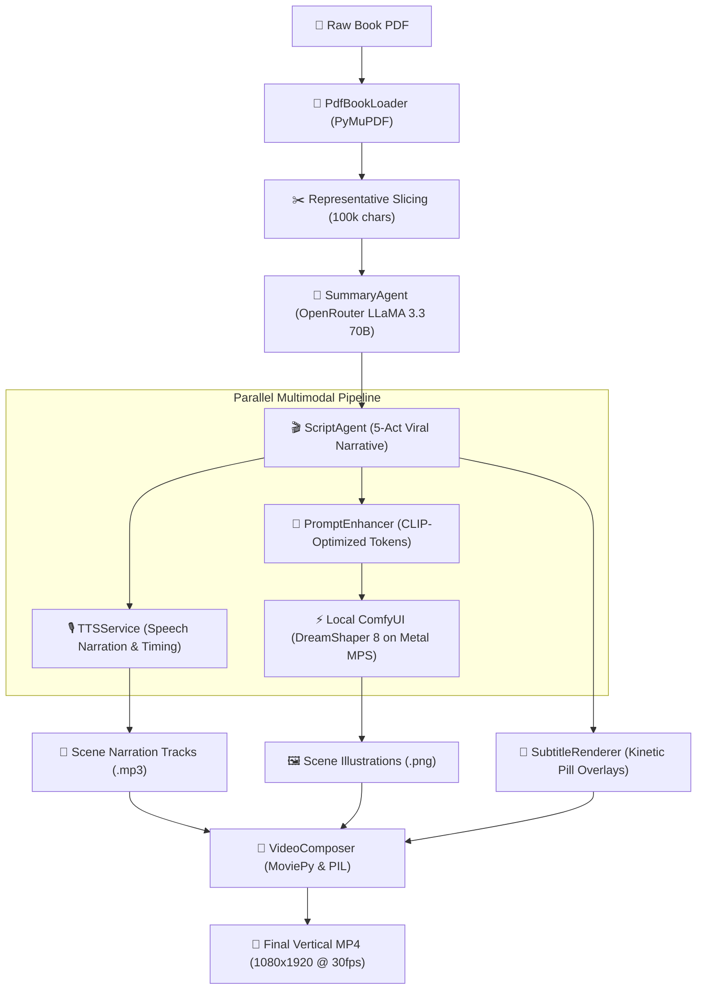

# Narrify AI — Technical Architecture & System Documentation

## 1. System Overview

**Narrify AI** is an automated multimodal generative engine that transforms long-form literature (PDF books and manuscripts) into short-form vertical videos (9:16, 1080×1920) optimized for platforms like YouTube Shorts, Instagram Reels, and TikTok.

The engine coordinates cloud-based large language models (LLMs) for high-context narrative synthesis with local diffusion models (ComfyUI via Apple Silicon Metal Performance Shaders) for high-fidelity illustration rendering, voice synthesis, kinetic subtitles, and dynamic camera choreography.



---

## 2. Architectural Subsystems

### 2.1 PDF Ingestion & Context Management (`app/loaders/pdf_loader.py`)
* **Library**: `pymupdf` (fitz).
* **Extraction**: Fast C-based text extraction retaining page counts, title, author, and word counts.
* **Context Protection**: Standard full-text ingestion easily exceeds LLM context windows or triggers admission timeouts on massive books (e.g. 70,000+ words). The ingestion engine samples a representative tripartite slice of the book:
  $$\text{Payload} = \text{Preface / Opening } \left(\frac{N}{3}\right) + \text{Core Body } \left(\frac{N}{3}\right) + \text{Conclusion / Lessons } \left(\frac{N}{3}\right)$$
  capped at 100,000 characters to preserve deep narrative context without payload bloat.

### 2.2 Cloud LLM Inference Engine (`app/services/llm.py`)
* **Default Provider**: OpenRouter Cloud API (`meta-llama/llama-3.3-70b-instruct`).
* **Fallback Provider**: Local Ollama instance.
* **Structured Output**: Enforces strict JSON schemas using response formatting.
* **Resilience Features**:
  - `_clean_json_output`: Strips markdown triple backticks (```json ... ```) automatically.
  - **Admission Control Retry**: Handles HTTP 429 rate limits with exponential backoff using `Retry-After` headers.

### 2.3 Viral 5-Act Narrative & Pacing Engine (`app/agents/script_agent.py`)
To prevent dry, clinical summaries and abrupt endings, `ScriptAgent` enforces a 5-act retention framework:

| Scene | Duration | Dramatic Beat | Functional Purpose |
| :--- | :--- | :--- | :--- |
| **Scene 1** | 3–6s | **The Hook** | Counter-intuitive question or pattern interrupt stopping the user's scroll. |
| **Scene 2** | 4–6s | **The Conventional Trap** | Highlights why common advice fails and the pain of being stuck. |
| **Scene 3** | 6–8s | **The Breakthrough Insight** | Introduces the core mental model paired with a vivid physical visual metaphor. |
| **Scene 4** | 5–7s | **The Actionable Protocol** | Gives a concrete micro-habit rule (e.g., 2-minute rule, habit stacking). |
| **Scene 5** | 5–6s | **Triumphant Payoff** | Inspiring transformation arc with a memorable call-to-action. |

* **Validation**: Validated using Pydantic (`ScriptResponse`) with `min_length=4` scene constraints.

### 2.4 CLIP-Compliant Diffusion Prompt Enhancer (`app/services/prompt_enhancer.py`)
Diffusion models using CLIP ViT-L/14 text encoders possess a 77-token limit and fail when presented with markdown headers, formatting lines, or negative words in positive prompts.
* **Token Prioritization**: Direct physical subject + primary action placed within the first 25 tokens.
* **Style Preset Descriptors**: Injects dense artistic descriptors based on `ImageStyle` (`HANDWRITTEN`, `CARTOON`, `CHALKBOARD`, `WATERCOLOR`).
* **Negative Prompting**: Dedicated negative token list removing extra limbs, distorted anatomy, signatures, watermarks, and deformed faces.

### 2.5 Local GPU Image Generation (`app/renderers/image_renderer.py`)
* **Server**: Local ComfyUI daemon running on `http://127.0.0.1:8188`.
* **Hardware Acceleration**: Apple Silicon Metal Performance Shaders (`mps`) with unified memory management.
* **Model Workflow**: `DreamShaper_8_pruned.safetensors` (SD 1.5 optimized checkpoint) configured in `app/workflows/dreamshaper.json`.
* **Rendering Metrics**:
  - Resolution: Native $512 \times 896$ (9:16 vertical aspect ratio).
  - Sampler: DPM++ 2M Karras, 20 steps, CFG scale 7.0.
  - Generation Speed: $\sim 1.3\text{ s/it}$ ($\sim 25\text{ seconds}$ per scene on Apple Silicon GPU).
* **Automated Asset Retrieval**: Communicates via ComfyUI WebSocket/REST endpoints (`/prompt`, `/history`, `/view`) to trigger execution and automatically download generated PNGs to `output/images/scene_XXX.png`.

### 2.6 Audio Narration & Subtitle Engine (`app/services/tts.py` & `subtitle_renderer.py`)
* **TTS Synthesis**: macOS native speech synthesizer (`say`) encoded via `imageio_ffmpeg` into standard 44.1 kHz stereo MP3 with sub-second speech duration measurement.
* **Typography Without ImageMagick**: MoviePy's standard `TextClip` relies on ImageMagick, which is frequently broken or missing on macOS. Narrify AI implements a custom Pillow RGBA subtitle renderer:
  - Generates rounded translucent pill backdrops (`RGBA: 0, 0, 0, 190`).
  - Renders multi-line centered text with drop shadows for 100% legibility across light and dark image backgrounds.
  - Positions subtitles dynamically in the lower third ($y = 78\%$).

### 2.7 Video Composition & Ken Burns Choreography (`app/services/video_composer.py`)
* **Aspect Ratio**: Full HD $1080 \times 1920$ vertical canvas.
* **Smart Cropping**: Scales and center-crops 9:16 source images to exactly 1080×1920 without stretching or black bars.
* **Dynamic Motion**: Alternates subtle Ken Burns zoom-in ($1.0 \to 1.04$) and zoom-out ($1.04 \to 1.0$) using `vfx.Resize` and `vfx.Crop` to transform static illustrations into cinematic video.
* **Export**: Fast H.264 video encoding (`yuv420p` pixel format) and AAC audio encoding at 30 fps.

---

## 3. Directory Layout

```
narrify-ai/
├── app/
│   ├── agents/                     # LLM orchestration agents
│   │   ├── creative_director_agent.py
│   │   ├── script_agent.py         # 5-act viral narrative engine
│   │   ├── storyboard_agent.py
│   │   └── summary_agent.py        # Long-context book summarizer
│   ├── config/                     # Render and style settings
│   │   ├── image_styles.py
│   │   └── render.py
│   ├── core/                       # App settings & environment loaders
│   │   └── config.py
│   ├── domain/models/              # Domain dataclasses & Pydantic schemas
│   │   ├── book.py
│   │   ├── scene.py
│   │   ├── script.py
│   │   ├── script_response.py      # Strict validation schema
│   │   └── video_blueprint.py
│   ├── loaders/                    # Document parsing
│   │   └── pdf_loader.py
│   ├── prompts/                    # Prompts for LLM agents
│   │   ├── script_writer.txt
│   │   ├── summary.txt
│   │   └── ...
│   ├── renderers/                  # ComfyUI interface
│   │   └── image_renderer.py
│   ├── services/                   # Core business logic services
│   │   ├── llm.py                  # OpenRouter & Ollama client
│   │   ├── prompt_enhancer.py      # CLIP diffusion prompt builder
│   │   ├── subtitle_renderer.py    # Pillow subtitle pill renderer
│   │   ├── tts.py                  # Audio synthesis engine
│   │   └── video_composer.py       # MoviePy Ken Burns assembly
│   └── workflows/                  # ComfyUI workflow JSON schemas
│       ├── dreamshaper.json
│       └── flux.json
├── books/                          # Input book PDFs
├── output/                         # Rendered artifacts
│   ├── audio/                      # Per-scene voice narration MP3s
│   ├── images/                     # Per-scene rendered PNGs
│   └── *_video.mp4                 # Exported final vertical videos
├── tests/                          # Automated Pytest suite
│   ├── test_llm_service.py
│   ├── test_prompt_enhancer.py
│   ├── test_script_agent.py
│   ├── test_text_cleaner.py
│   └── test_video_pipeline.py
├── main.py                         # Typer CLI application entry point
├── pyproject.toml                  # UV project configuration
└── task.md                         # Active development roadmap & backlog
```

---

## 4. CLI Reference

### `video` (Full End-to-End Pipeline)
Generates complete vertical video with voice narration, illustrations, subtitles, and motion:
```bash
uv run python main.py video books/atomic_habits.pdf [OPTIONS]
```
**Options**:
- `--scenes`, `-n`: Number of scenes to generate (default: `5`).
- `--voice`: Narrator voice (`Samantha`, `Daniel`, `Karen`).
- `--style`: Artistic illustration style (`HANDWRITTEN`, `CARTOON`, `CHALKBOARD`, `WATERCOLOR`).
- `--force`, `-f`: Force re-rendering of existing scene images and audio.
- `--limit`: Render only the first $k$ scenes.
- `--output`: Custom output directory (default: `output/`).

### `summarize` (Script Preview)
Extracts key insights and generates a 5-scene narrative script without triggering image or video rendering:
```bash
uv run python main.py summarize books/atomic_habits.pdf --scenes 5
```

### `blueprint` (Diffusion Prompt Preview)
Generates enriched CLIP-compliant diffusion prompts for each scene:
```bash
uv run python main.py blueprint books/atomic_habits.pdf --style HANDWRITTEN
```

### `render-images` (ComfyUI Illustration Only)
Renders illustrations directly via ComfyUI without assembling video:
```bash
uv run python main.py render-images books/atomic_habits.pdf
```

---

## 5. Environment & Configuration Reference

Configured via `.env`:

```ini
# LLM Provider Configuration
LLM_PROVIDER=openrouter
OPENROUTER_API_KEY=sk-or-v1-xxxxxxxxxxxxxxxxxxxx
OPENROUTER_BASE_URL=https://openrouter.ai/api/v1
LLM_MODEL=meta-llama/llama-3.3-70b-instruct
LLM_TEMPERATURE=0.7

# Local ComfyUI Configuration
IMAGE_PROVIDER=comfyui
IMAGE_MODEL=flux
COMFYUI_HOST=127.0.0.1
COMFYUI_PORT=8188

# Video Render Parameters
RENDER_WIDTH=1080
RENDER_HEIGHT=1920
RENDER_FPS=30
```

---

## 6. Testing & Quality Assurance

Narrify AI maintains an automated test suite executed via `pytest`:

```bash
uv run pytest
```

| Test Suite | Coverage Focus |
| :--- | :--- |
| `tests/test_llm_service.py` | OpenRouter REST communication, API key validation, markdown stripping. |
| `tests/test_prompt_enhancer.py` | CLIP token limits, prompt cleanliness, style descriptor injection. |
| `tests/test_script_agent.py` | 5-scene viral schema validation, rejection of truncated scene arrays. |
| `tests/test_video_pipeline.py` | Pillow subtitle rendering, TTS synthesis, MoviePy scene assembly. |
